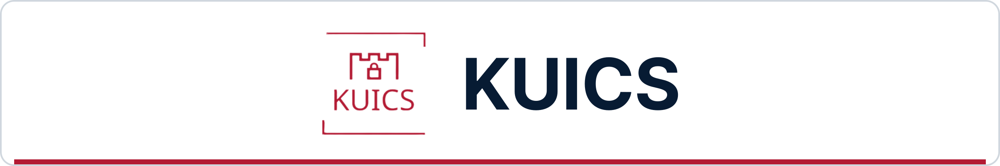
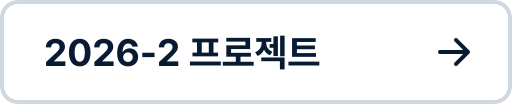

<a href="https://kuics.korea.ac.kr/"><picture><source media="(prefers-color-scheme: dark)" srcset="https://raw.githubusercontent.com/KUICS-KU/.github/main/assets/banner-dark.png"></picture></a>

고려대학교 정보대학 컴퓨터학과 보안동아리 Korea University Institute of Computer Security

<a href="https://kuics.korea.ac.kr/"><picture><source media="(prefers-color-scheme: dark)" srcset="https://raw.githubusercontent.com/KUICS-KU/.github/main/assets/btn-home-dark.png"></picture></a> <a href="https://github.com/KUICS-KU/Project-2026-2"><picture><source media="(prefers-color-scheme: dark)" srcset="https://raw.githubusercontent.com/KUICS-KU/.github/main/assets/btn-semester-dark.png"></picture></a>

## 학기별 프로젝트

보안 프로젝트의 소개, 코드와 공개 결과물을 학기별로 모았습니다.

| 학기 | 프로그램 | 바로가기 |
| :--- | :--- | :--- |
| **2026학년도 2학기** | 보안 멘토링 프로젝트 | **[프로젝트 둘러보기 →](https://github.com/KUICS-KU/Project-2026-2)** |

[홈페이지](https://kuics.korea.ac.kr/) · [활동 기록](https://kuics.korea.ac.kr/activity) · [공지사항](https://kuics.korea.ac.kr/board)
