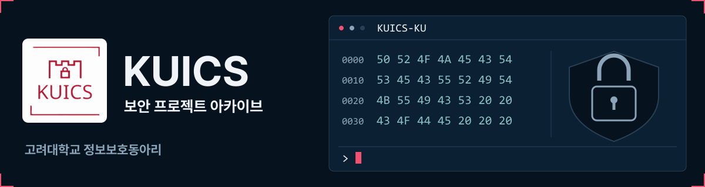

<a href="https://kuics.korea.ac.kr/"><picture><source media="(prefers-reduced-motion: reduce)" srcset="https://raw.githubusercontent.com/KUICS-KU/.github/main/assets/security-console.png"></picture></a>

<a href="https://kuics.korea.ac.kr/">🌐 홈페이지</a> · <a href="https://github.com/KUICS-KU/Project-2026-2">📂 프로젝트</a> · <a href="https://www.instagram.com/kuics.official/">📷 Instagram</a> · <a href="https://script.google.com/macros/s/AKfycbwtns7yDOVE-0kfdcy06GR2FuNAZD4lkCInuwqH2ZcmB2r_dSygvrFmn4V6ecztxIOpuA/exec?view=apply">👋 가입 신청</a>

<a href="#학기별-프로젝트">학기별 목록</a> · <a href="#kuics-소개">KUICS 소개</a> · <a href="#주요-활동">활동</a> · <a href="#참여와-소식">참여와 소식</a>

## 학기별 프로젝트

팀이 탐구한 문제부터 구현 코드, 발표와 공개 보고서까지 학기별로 연결합니다. 학기를 선택하면 각 팀의 소개와 관련 저장소를 둘러볼 수 있습니다.

팀 코드 저장소는 비공개이며, 운영진 승인 후 소속 팀 저장소를 조회할 수 있습니다. [👋 가입 신청](https://script.google.com/macros/s/AKfycbwtns7yDOVE-0kfdcy06GR2FuNAZD4lkCInuwqH2ZcmB2r_dSygvrFmn4V6ecztxIOpuA/exec?view=apply)

| 학기 | 프로그램 | 바로가기 |
| :--- | :--- | :--- |
| **2026학년도 2학기** | 보안 멘토링 프로젝트 | **[프로젝트 둘러보기 →](https://github.com/KUICS-KU/Project-2026-2)** |

## KUICS 소개

**KUICS**(퀵스)는 **2005년 1월 11일** 설립된 고려대학교 정보대학 소속 정보보호동아리입니다. 정보보호에 대한 학문적 호기심과 올바른 윤리의식을 바탕으로 보안기술, 해킹과 방어기법, 해킹사고 대응을 연구합니다.

스터디에서 기초 지식과 관심 분야를 익히고, 팀 프로젝트에서는 직접 문제를 정해 탐구하고 구현합니다. 멘토링을 통해 접근 방법을 점검하고, 진행 과정과 결과를 기록해 동료와 다음 학기 참여자들이 참고할 수 있도록 남깁니다.

[공식 홈페이지에서 KUICS 소개 보기 →](https://kuics.korea.ac.kr/about)

## 주요 활동

| 활동 | 함께하는 내용 |
| :--- | :--- |
| **기초·심화 스터디** | 프로그래밍과 시스템의 기초부터 웹, 포너블, 버그 바운티, AI 보안 논문까지 관심 분야를 학기별로 공부합니다. |
| **보안 멘토링 프로젝트** | 팀별 보안 주제를 정하고, 멘토의 피드백을 반영하며 탐구와 개발을 진행합니다. |
| **성과 기록과 공유** | 중간·최종보고서와 발표, 시연 가능한 결과물로 프로젝트의 과정과 성과를 정리합니다. |

<strong>2026학년도 2학기 스터디 둘러보기</strong>

- **프로그래밍:** Basic Python, Advanced Python
- **시스템과 웹:** Linux & OS, Web & Internet
- **보안 심화:** 포너블, 버그 바운티, AI 보안 논문

각 스터디의 커리큘럼과 활동 정보는 [스터디 페이지](https://kuics.korea.ac.kr/study)에서 확인할 수 있습니다.

<strong>이 아카이브에서 볼 수 있는 자료</strong>

- **학기 허브:** 프로그램 소개, 팀 목록과 주요 일정
- **팀 소개:** 팀·멘토, 연구 주제와 목표, 공개 보고서·발표 자료
- **코드 저장소:** 구현·실험 코드, 실행 환경과 재현 방법

공개된 자료가 생기면 각 팀의 소개 페이지에 연결합니다. 회차별 활동보고서는 기존 홈페이지의 제출·열람 절차를 따릅니다.

## 참여와 소식

모집과 주요 공지는 공식 홈페이지에서 안내합니다. 스터디와 프로젝트 활동, 공개된 결과물도 홈페이지에서 함께 확인할 수 있습니다.

[공지·모집](https://kuics.korea.ac.kr/board) · [스터디](https://kuics.korea.ac.kr/study) · [활동 기록](https://kuics.korea.ac.kr/activity) · [문의](https://kuics.korea.ac.kr/contact) · [Instagram](https://www.instagram.com/kuics.official/)
